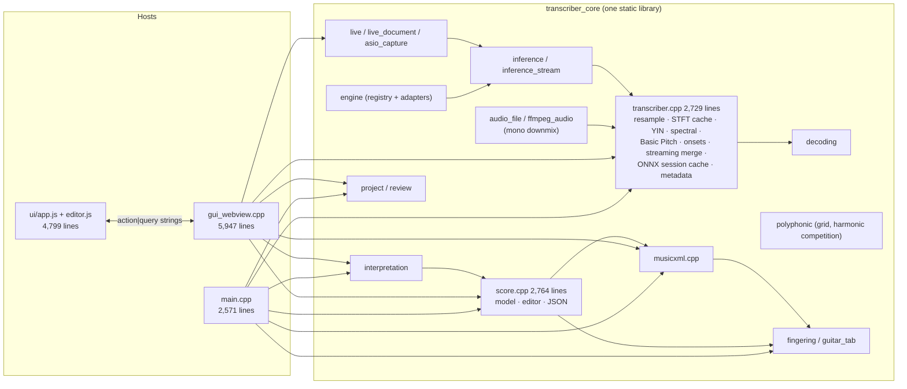
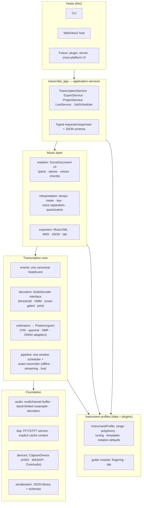
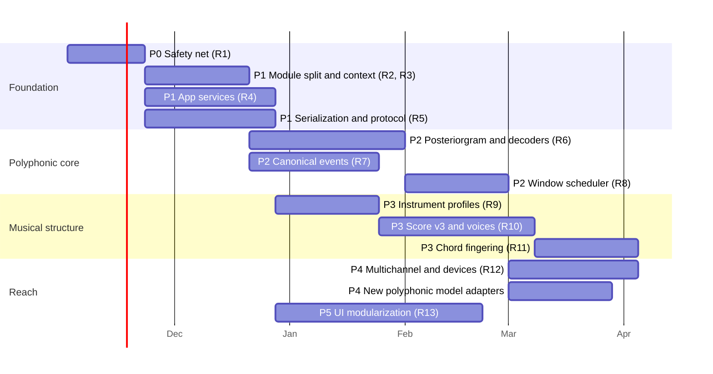

# Architecture review

Review date: 2026-10-29. Source baseline: `2a4c943` (Transcriber 0.1.8).
Perspective: long-term maintainability, extensibility, and the path to robust
polyphonic transcription.

> **Status update for 0.1.9 (2026-10-30):** This review's line counts, findings,
> and severity ranking describe the 0.1.8 baseline above. Since that snapshot,
> the project has added a versioned in-process model-provider/contract
> registry, canonical confidence and correction reporting, musical analysis,
> and an opt-in tracked polyphonic pipeline. The provider API partially
> addresses A10, but it is not a stable binary plugin ABI; GUI provider
> selection and hardware qualification remain outstanding. The one-part score,
> mono-input, and per-pitch decoding constraints in A01-A04 remain relevant.
> Use the current feature documentation for shipped behavior and this review
> for its explicitly dated structural baseline.

This document complements the defect-oriented
[engineering audit](engineering-audit.md). That audit catalogs correctness
defects (C01–C13). This review covers **structural** problems: how
responsibilities, data models, and dependencies are arranged, and what that
arrangement will cost as the product grows. Where an audit defect is a symptom
of an architectural cause, it is cross-referenced rather than restated.

Contents:

1. [Architecture review](#1-architecture-review)
2. [Severity ranking](#2-severity-ranking)
3. [Refactoring plan](#3-refactoring-plan)
4. [Implementation roadmap](#4-implementation-roadmap)

---

## 1. Architecture review

### 1.1 Shape at the 0.1.8 baseline



The intended pipeline is clear and well documented: audio acquisition →
DSP/model inference → note events → musical interpretation → canonical score →
exporters, with the GUI as an editing layer. Several of the newer contracts
are very good and should be the foundation of the refactor:

- **Versioned engine and model contracts.** `TranscriptionEngine`,
  `IncrementalEngine`, `ModelBackend`, capability metadata, and explicit
  single-owner semantics ([engine.hpp](../include/transcribe/engine.hpp),
  [inference.hpp](../include/transcribe/inference.hpp)).
- **Canonical, sample-referenced events with provenance and lifecycle**
  (`CanonicalNoteEvent`, `EventLifecycle`, `EventEvidence` in
  [decoding.hpp](../include/transcribe/decoding.hpp)).
- **A frame-by-pitch activation contract** (`PitchActivationGrid` in
  [polyphonic.hpp](../include/transcribe/polyphonic.hpp)) with explicit
  semantics, objective, and head alignment.
- **A disciplined live pipeline:** SPSC ingestion, explicit gap/discontinuity
  semantics, bounded queues, and callback-free analysis
  ([live.hpp](../include/transcribe/live.hpp)).
- **Transactional score editing** with revisions, provenance, and undo/redo
  ([score.hpp](../include/transcribe/score.hpp)); atomic project writes.
- **Unusually strong evaluation discipline**: synthetic corpora, GuitarSet
  runs, release gates, paired measurements, and a broad CI matrix.

The problem is not missing ideas. It is that these newer contracts were added
**alongside** the original monophonic architecture instead of replacing it.
The codebase now carries two architectures at once, and most of the
structural risk comes from the seams between them.

### 1.2 Core finding: polyphony is emulated, not modeled

The single most important structural fact for the product's future:

> Every polyphonic path (spectral salience, harmonic competition, Basic Pitch)
> converts multi-pitch evidence into **one monophonic `PitchFrame` track per
> MIDI pitch**, then runs each track independently through the single-pitch
> `notes_from_frames` helper.

Evidence:

- Spectral: [transcriber.cpp](../src/transcriber.cpp#L570) builds
  `pitch_frames[pitch]` for every pitch on every frame (mostly `-1` entries),
  then calls `notes_from_frames` once per pitch
  ([transcriber.cpp](../src/transcriber.cpp#L582)).
- Basic Pitch: the same pattern at
  [transcriber.cpp](../src/transcriber.cpp#L1127), with onset and contour
  heads attached as side vectors on each per-pitch track.
- `FrameEvidenceTrack` holds a `std::vector<PitchFrame>` where each frame has a
  single scalar `midi_pitch`
  ([transcriber.hpp](../include/transcribe/transcriber.hpp)); decoding consumes
  scalar `f.midi_pitch` ([decoding.cpp](../src/decoding.cpp#L382)).
- `PitchActivationGrid` exists, but it is **reconstructed after the fact** from
  fixed-pitch tracks ([polyphonic.cpp](../src/polyphonic.cpp#L50)). It is an
  output projection, not the internal currency.

Consequences:

| Consequence | Why it matters |
|---|---|
| No joint decoding | Each pitch is decided in isolation. Octave/harmonic suppression, polyphony limits, voice leading, and onset sharing across pitches cannot be expressed in the decoder. |
| One global onset stream | Onsets come from broadband audio ([transcriber.hpp](../include/transcribe/transcriber.hpp) `detect_onset_evidence`) and are shared by all pitches, so a re-strike of one chord tone cannot be distinguished from a new note on another string. |
| Memory amplification | An 88-pitch model stores 88 × frames `PitchFrame` structs (~56 B each on 64-bit) instead of one dense float tensor (4 B per cell). A 10-minute file at 86 fps is ~4.5M structs (~250 MB) before evidence vectors, versus ~18 MB as a float posteriorgram. |
| Head semantics bolted on | Onset, offset/note-state, and contour heads are optional side arrays on a monophonic track. A model with velocity or offset heads has nowhere principled to put them. |
| Two decoders | `NeuralNoteDecoder::Legacy` vs `MultiHeadEvents`, and `SpectralDecoder::LegacySalience` vs `HarmonicCompetition`, select between paths at runtime instead of composing stages. |

Everything downstream inherits this. The score and live sections below
describe the same limitation at higher layers.

### 1.3 Findings by area

Each finding has a stable ID (Axx) used in the ranking and plan.

#### Data model

**A01 — Polyphony emulated as per-pitch monophonic tracks** (see §1.2).

**A02 — Seven overlapping note representations, with the legacy `Note` as the
lingua franca.** The repository has `Note`, `NoteEvent`, `PitchFrame`,
`CanonicalNoteEvent`, `EngineNoteEvent`, `live::LiveNote`, `InterpretedNote`,
and `ScoreNote`. `Note` has no sample position, voice, velocity, instrument,
or provenance, yet it is still what the detectors return, what
`interpret_notes` consumes, what guitar tab consumes
([guitar_tab.hpp](../include/transcribe/guitar_tab.hpp)), and what
`EngineUpdate::notes` carries next to the richer `events`
([engine.hpp](../include/transcribe/engine.hpp)). Every boundary crossing is a
lossy, hand-written conversion, and new fields must be threaded through
several types.

**A03 — The score has no part, staff, or per-voice timeline.**
`ScoreDocument` is one `ScoreInstrument` plus flat `notes`/`rests` vectors.
`voice` is an integer attribute, `chord_group_id` is optional metadata with no
invariant that members share an onset or duration, and rests are generated
from a global gap reconstruction
([interpretation.cpp](../src/interpretation.cpp#L645)). Piano grand staff,
multi-instrument ensembles, independent voice rests, and cross-staff notation
cannot be represented without a schema change.

**A04 — Audio is mono by construction.** `AudioBuffer` is
`{sample_rate, samples}`; WAV decoding averages all channels
([audio_file.cpp](../src/audio_file.cpp#L252)); FFmpeg forces 44.1 kHz mono
([ffmpeg_audio.cpp](../src/ffmpeg_audio.cpp#L130)); live recording is
explicitly mono-downmixed. Stereo cues, multi-mic setups, hexaphonic guitar
pickups (the strongest practical route to guitar polyphony), and
separated-stem workflows ([instrument-isolation.md](instrument-isolation.md))
all have to bypass the core type.

#### Module structure and coupling

**A05 — `transcriber.cpp` is a 2,729-line god module.** It contains linear
resampling, an FFT plan cache, a process-global STFT cache, YIN, spectral
salience, harmonic competition glue, the Basic Pitch ONNX adapter, onset
detection, `notes_from_frames`, chunked WAV streaming and merge, generic ONNX
dispatch, a process-global ONNX session cache, and score-metadata inference.
Any change to one estimator recompiles and risks all of them, and the file has
no internal seams that tests can target.

**A06 — Five parallel pipeline drivers with different seam policies.**
Overlapping-window or chunked processing is implemented separately in
`transcribe_wav_streaming` ([transcriber.cpp](../src/transcriber.cpp#L2185)),
`infer_wav_file` ([inference_stream.cpp](../src/inference_stream.cpp)), the
Basic Pitch window stitcher, the live windowed reconciler
([live.cpp](../src/live.cpp)), and `refine_windowed`
([live_document.cpp](../src/live_document.cpp)). Each has its own overlap,
duplicate-resolution, and boundary rules. Polyphonic seam reconciliation
(the same chord tone present in two windows) has to be solved five times.

**A07 — Application hosts own domain orchestration.** The library boundary
exists (`transcriber_core`), but both hosts re-implement the workflow:

| Function | File | Approx. size | Responsibilities |
|---|---|---:|---|
| `process_input` | [main.cpp](../src/main.cpp#L1372) | ~400 lines | decode, preprocess, infer, interpret, finger, export |
| `process_batch` | [main.cpp](../src/main.cpp#L2292) | ~240 lines | scheduling, memory admission, journaling, cancellation |
| `handle_web_message` | [gui_webview.cpp](../src/gui_webview.cpp#L4682) | ~560 lines | protocol dispatch for every UI action |
| `perform_live_capture` | [gui_webview.cpp](../src/gui_webview.cpp#L2492) | ~380 lines | capture orchestration, polling, bridge state |
| `export_edited_score` | [gui_webview.cpp](../src/gui_webview.cpp#L3549) | ~330 lines | export policy and file writing |
| `drain_live_bridge` | [gui_webview.cpp](../src/gui_webview.cpp#L5245) | ~300 lines | live event translation |

Option parsing is duplicated too: instrument names are mapped in
[main.cpp](../src/main.cpp#L500), again in [main.cpp](../src/main.cpp#L667),
and again in [gui_webview.cpp](../src/gui_webview.cpp#L1724). Audit
findings C02, C03, C07, F16, F17, and F22 are all symptoms of this: the same
policy is implemented per host and drifts.

**A08 — Hand-rolled serialization in at least six places.** Score/project
JSON writing and parsing in [score.cpp](../src/score.cpp#L2100) (~660 lines),
project JSON in [project.cpp](../src/project.cpp), CLI event/summary JSON in
[main.cpp](../src/main.cpp#L846), GUI wide-string JSON in
[gui_webview.cpp](../src/gui_webview.cpp#L481), MusicXML via `operator<<`
in [musicxml.cpp](../src/musicxml.cpp), and the URL-encoded `action|query`
UI bridge ([app.js](../ui/app.js#L74)). There is no shared schema, so the
C++ writers, JS readers, Python evaluators, and migration code can disagree
silently. Schema migration is a hand-written branch per version
([score.cpp](../src/score.cpp#L2525)) rather than a registry.

**A09 — Guitar assumptions leak into generic layers.**

- `score.hpp` includes `guitar_tab.hpp`; `make_score_document` takes
  `GuitarTabOptions`; `ScoreInstrument` defaults to standard guitar tuning.
- MusicXML rendering runs fingering/tab inference during export
  ([musicxml.cpp](../src/musicxml.cpp#L925)), so a notation writer depends on
  an instrument-specific search algorithm.
- The generic spectral decoder hard-codes per-instrument MIDI ranges and
  polyphony caps (guitar 40–88 / 6 voices, piano 10, voice 2, bass 4)
  ([transcriber.cpp](../src/transcriber.cpp#L409)).
- `InstrumentPrior` is a closed enum; `prepare_audio` accepts only a fixed
  set of names ([preprocessing.cpp](../src/preprocessing.cpp#L63)).

Adding an instrument currently means editing enums and `switch` statements
across DSP, preprocessing, CLI, GUI, and score code.

**A10 — Closed model contracts.** `ModelContract` is an enum
(`Yin, Spectral, BasicPitchV1, LegacyPitchV1`), and the Basic Pitch adapter
detects the model by fixed tensor dimensions inside `transcriber.cpp`.
Registries are in-process factory lists only; the
[engine plugin example](../examples/engine_plugin.cpp) is a static
registration demo, not a loadable ABI. Every new polyphonic model
(Onsets & Frames, MT3-style, a guitar-specific tab model) requires core edits.

**A11 — Process-global mutable caches.** One process-wide spectrogram slot
guarded by a static mutex and keyed by a full-audio hash
([transcriber.cpp](../src/transcriber.cpp#L327)), and a process-lifetime
ONNX session map ([transcriber.cpp](../src/transcriber.cpp#L713); audit C08).
These create hidden coupling between unrelated callers (two GUI jobs evict
each other's spectrogram), make performance non-deterministic, prevent
per-session memory budgets (audit C06), and complicate testing.

**A12 — Feature flags as configuration surface.** `AnalysisOptions` and
`OnnxOptions` each carry `polyphonic`, thresholds, pitch caps, progress and
evidence callbacks, cancellation, and decoder selectors
(`independent_probabilities`, `aligned_model_heads`, `note_decoder`,
`spectral_decoder`). The valid combinations are implicit; audit F20
(polyphonic checkbox silently ran monophonic analysis) is the predictable
outcome. Callbacks inside option structs also make options non-copyable
values in practice and blur configuration with runtime wiring.

**A13 — Dual error model.** Public model/engine APIs return
`std::variant<T, InferenceError>`, while DSP, I/O, score, and project code
throw `runtime_error`/`invalid_argument`. Every host has to handle both, and
error codes do not survive across the exception boundary.

#### Performance

**A14 — Performance hot spots that will scale badly with polyphony and long
inputs.**

| Hot spot | Location | Cost driver |
|---|---|---|
| Per-pitch `PitchFrame` tracks | [transcriber.cpp](../src/transcriber.cpp#L570) | `O(pitches × frames)` structs plus a linear `find_if` per pitch per frame |
| Time-domain YIN difference function | [transcriber.cpp](../src/transcriber.cpp#L68) | `O(frames × lags × window)`; the FFT-based autocorrelation form is `O(frames × W log W)` |
| Full-audio hash before every spectrogram lookup | [transcriber.cpp](../src/transcriber.cpp#L313) | Extra pass over all samples even on cache hit |
| Harmonic competition | [polyphonic.cpp](../src/polyphonic.cpp#L144) | Allocates `residual`/`activity` per frame; 12 dense sweeps over all templates |
| Nested parallelism | [transcriber.cpp](../src/transcriber.cpp#L391) | `std::async` workers (cap 8) inside callers that may already be parallel; no shared executor |
| Linear resampler | [transcriber.cpp](../src/transcriber.cpp#L204) | Aliasing (audit C04) and a full copy per stage; FFmpeg resamples to 44.1 kHz first, then analysis resamples again |
| Chunk assembly | [inference_stream.cpp](../src/inference_stream.cpp), [transcriber.cpp](../src/transcriber.cpp#L2300) | Repeated `insert` into overlapping chunk buffers |
| FFmpeg decode | [ffmpeg_audio.cpp](../src/ffmpeg_audio.cpp#L170) | New vector per decoded frame |
| Score undo | [score.hpp](../include/transcribe/score.hpp) `ScoreEditor::Snapshot` | Full `ScoreDocument` copied **twice** per edit (before/after), up to 100 deep |
| Chord fingering | [fingering.cpp](../src/fingering.cpp#L224) | Recursive `O((c+1)^k)` per chord; beam up to 4096 × 4096 local solutions; hard 64-note cutoff; `O(N²)` fixed-position checks |

None of these is urgent for short monophonic guitar clips. All of them grow
with the inputs polyphonic transcription brings: more pitches per frame,
longer pieces, denser chords, larger scores.

#### Live and real-time

**A15 — Incremental live tracking holds exactly one active note.** The YIN
live backend stores `std::optional<Tracked> yin_active`
([live.cpp](../src/live.cpp#L1236)) and closes it whenever a different pitch
starts ([live.cpp](../src/live.cpp#L571)). The windowed backend tracks
multiple notes, but seam matching uses pitch and onset distance only, with no
voice/string identity, so repeated or doubled pitches can merge.
`ScoreProposal` carries flat `LiveNote` objects.

**A16 — Device layer is ASIO-only and buried in orchestration.** RtAudio is
hard-wired to `WINDOWS_ASIO` ([asio_capture.cpp](../src/asio_capture.cpp#L64)),
and `capture_asio_stream_impl` (~300 lines) mixes device validation,
reconnect, polling, progress, and teardown. The good news: `AudioInputSink`
and `AudioFrameBlock` are already device-neutral, so a `CaptureDevice`
interface can be extracted without touching the session.

**A17 — Live latency budget and scheduling are static.** Polling intervals
(1 ms ingest, 5 ms analysis wait), default 2 s windowed context against a
1 s `max_analysis_lag_seconds`, model compute excluded from the budget, and
gap markers coalesced after 1024 entries. The SPSC single-producer
requirement is documented but not enforced. These are reasonable now but
are not adaptive to GPU latency, larger models, or multiple concurrent
sources.

#### Presentation and tooling

**A18 — UI is two script monoliths on a global event bus.** `app.js`
(2,256 lines) and `editor.js` (2,543 lines) are classic scripts sharing
`window`, DOM lookups, `localStorage`, and custom events. The canvas notation
view and exported notation are separate renderers (audit F21). Testing
requires a browser harness ([ui_workflow.js](../tests/ui_workflow.js)).

**A19 — Single monolithic library target and CMake file.** One 752-line
`CMakeLists.txt` and one `transcriber_core` library mean the dependency
direction between DSP, inference, score, and export is not enforced by the
build. Nothing prevents `score` from depending on `fingering` (it already
does) or DSP from depending on ONNX.

**A20 — Generated evaluation artifacts in git and CLI-shaped tooling
contracts.** About 3.6 MB of JSON reports under
[python/evaluation](../python/evaluation) are committed and will grow with
every release; Python evaluators depend on CLI flags and report shapes
rather than a versioned schema.

**A21 — Scattered magic numbers.** Analysis rate 11,025 Hz, YIN windows,
RMS floors, minimum durations, onset tolerances, MusicXML divisions, undo
depth, chord cutoffs, and polling intervals are literals across files rather
than named, documented, instrument- or model-scoped parameters.

---

## 2. Severity ranking

Severity combines **long-term cost** (how much future work it taxes),
**polyphonic blocking** (whether it prevents credible polyphonic output), and
**blast radius** (how many modules a change touches). It is not a bug
severity; correctness defects remain in the
[engineering audit](engineering-audit.md).

| Rank | ID | Finding | Severity | Polyphony blocker | Primary area |
|---:|---|---|---|---|---|
| 1 | A01 | Polyphony emulated as per-pitch monophonic tracks | **Critical** | Yes | Data model / decoding |
| 2 | A02 | Seven note representations; legacy `Note` as currency | **Critical** | Yes | Data model |
| 3 | A03 | No part/staff/voice timeline in the score | **Critical** | Yes | Score / notation |
| 4 | A06 | Five independent window/chunk drivers | **High** | Yes | Pipeline |
| 5 | A07 | Hosts own domain orchestration; duplicated policy | **High** | No | Layering |
| 6 | A08 | Hand-rolled serialization and untyped UI protocol | **High** | Indirect | Interop / persistence |
| 7 | A10 | Closed model contracts; no adapter extensibility | **High** | Yes | Inference |
| 8 | A05 | `transcriber.cpp` god module | **High** | Indirect | Module structure |
| 9 | A09 | Guitar assumptions in generic layers | **High** | Yes (non-guitar) | Coupling |
| 10 | A04 | Mono-by-construction audio | **High** | Yes (multi-source) | Audio I/O |
| 11 | A15 | Live incremental tracker is single-note | **High** | Yes (live) | Live |
| 12 | A11 | Process-global caches | **High** | No | Performance / concurrency |
| 13 | A14 | Hot spots that scale with pitches, length, and chord size | **Medium** | Indirect | Performance |
| 14 | A12 | Feature-flag option bags | **Medium** | Indirect | API design |
| 15 | A16 | ASIO-only device layer | **Medium** | No | Live / platform |
| 16 | A13 | Dual error model | **Medium** | No | API design |
| 17 | A18 | UI script monoliths | **Medium** | Indirect | Presentation |
| 18 | A19 | Monolithic library/CMake; unenforced dependency direction | **Medium** | No | Build |
| 19 | A17 | Static live scheduling and latency budget | **Medium** | Indirect | Live |
| 20 | A20 | Generated artifacts in git; CLI-shaped tooling | **Low** | No | Tooling |
| 21 | A21 | Scattered magic numbers | **Low** | Indirect | Maintainability |

**Reading the ranking.** A01–A03 form a single chain: frame evidence →
note events → score. Fixing one without the others moves the bottleneck
downstream, so they should be planned together even though they are
delivered in phases. A06–A09 are the enablers that make that chain cheap to
change. The rest are important but can proceed opportunistically.

---

## 3. Refactoring plan

### 3.1 Target architecture



Dependency rule: arrows point only downward. `instr` is consumed by `core`
(priors, templates) and `music` (notation defaults, tab), and depends only on
`base`. Each box becomes a CMake target so the rule is enforced by the
linker, not by convention.

### 3.2 Key abstractions

These are the contracts the refactor converges on. Names are proposals.

```cpp
// Dense, model-agnostic frame × pitch evidence. Replaces per-pitch PitchFrame tracks.
struct Posteriorgram {
    TimeAxis time;                       // sample rate, hop, origin, window, frame count
    PitchAxis pitch;                     // min MIDI, bins per semitone, count
    EvidenceSemantics semantics;
    PitchObjective objective;            // Monophonic | IndependentMultiPitch
    std::vector<float> activity;         // frames × bins, frame-major
    std::optional<std::vector<float>> onset, offset, velocity, contour;
    std::string method;
};

class PitchEstimator {                   // YIN, spectral, NMF, ONNX adapters
public:
    virtual EstimatorCapabilities capabilities() const = 0;
    virtual Posteriorgram estimate(AudioView audio, const EstimatorContext&) = 0;
};

class NoteDecoder {                      // threshold, onset-gated, HMM, joint/polyphony-limited
public:
    virtual DecodeResult decode(const Posteriorgram&, const DecodeContext&) = 0;
};

class WindowScheduler {                  // the only chunk/window/seam implementation
public:
    // Offline, progressive-file, and live all drive estimators through this.
    void push(AudioView block);
    std::vector<NoteEventDelta> poll();  // reconciled across window seams
};
```

- **YIN stays fast** by emitting a sparse/one-hot monophonic posteriorgram
  with `objective = Monophonic`. It does not pretend to be multi-pitch, but it
  flows through the same decoder interface.
- **One canonical `NoteEvent`** (evolved from `CanonicalNoteEvent`) carries
  sample positions, pitch, velocity, voice/string/instrument assignment,
  lifecycle, and provenance. `Note` becomes a deprecated projection produced
  by one adapter function.
- **ScoreDocument v3** introduces `Part → Staff → Voice → Event`, where an
  event is a `Chord` (shared onset/duration, one or more pitches) or `Rest`.
  Tab positions are attached through an instrument extension, not the core
  schema.
- **InstrumentProfile** is data (range, max polyphony, tuning, harmonic
  templates, default clef/transposition) loaded from a registry, with optional
  behavior plugins (guitar fingering).
- **ModelAdapter** descriptors declare tensor names, head roles, sample rate,
  window/hop/trim, and alignment as data, so new ONNX models are registered by
  descriptor rather than by editing `transcriber.cpp`.

### 3.3 Workstreams

Each workstream uses a strangler pattern: introduce the new contract, route
one path through it behind characterization tests, migrate the remaining
callers, then delete the old path. No workstream requires a long-lived
branch.

| WS | Name | Resolves | Summary |
|---|---|---|---|
| R1 | Safety net | prerequisite | Golden-output characterization tests for CLI JSON/MusicXML/MIDI/tab/project on fixed inputs; event-level regression on the synthetic corpus and a GuitarSet subset; perf and peak-memory baselines in CI. |
| R2 | Module split | A05, A19 | Split `transcriber.cpp` into `audio/`, `dsp/`, `estimators/yin`, `estimators/spectral`, `adapters/basic_pitch`, `onsets`, `legacy_pipeline`. Split CMake into per-layer targets with explicit `target_link_libraries` direction. Pure moves, no behavior change. |
| R3 | Explicit context | A11, A14 | Replace static spectrogram/FFT/ONNX caches with an `AnalysisContext` (owned by a session/job) holding an FFT plan pool, a bounded LRU spectrogram cache keyed by source identity rather than full-audio hash, and model sessions keyed by file identity. Shared thread-pool executor instead of nested `std::async`. |
| R4 | Application services | A07, A12, A13 | Extract `TranscriptionService`, `ExportService`, `ProjectService`, `LiveService`, `JobScheduler` into `transcribe_app`. Typed request structs replace host option parsing; one strict parser (fixes C03 uniformly). Services return `Result<T, Error>`; exceptions are converted at the service boundary. CLI and GUI become adapters. |
| R5 | Serialization and protocol | A08, A20 | Adopt one JSON library (for example nlohmann/json or glaze) behind `serialization/`. Define JSON Schemas for project, score, events, batch summary, and the UI bridge. Replace `action|query` with versioned JSON messages `{type, version, id, payload}` generated or validated from the schema on both sides. Migration registry (`vN → vN+1` functions) for project and score. Move generated evaluation reports to CI artifacts or release assets; keep small pinned fixtures. |
| R6 | Posteriorgram and decoders | A01, A12, A14 | Introduce `Posteriorgram`, `PitchEstimator`, `NoteDecoder`. Port Basic Pitch first (it is natively a posteriorgram), then spectral, then YIN as a monophonic posteriorgram. Replace `notes_from_frames` per-pitch loops with a decoder that sees all pitches. Retire `NeuralNoteDecoder` and `SpectralDecoder` flags in favor of composed estimator + decoder IDs. |
| R7 | Canonical events | A02 | Make `NoteEvent` (evolved `CanonicalNoteEvent`) the only type crossing estimator → interpretation → score → live. Single `to_legacy_notes()` adapter for API compatibility; deprecate `Note`-vector overloads (including legacy MusicXML, which also retires C10/C12). |
| R8 | Unified window scheduler | A06, A15, A17 | One `WindowScheduler` plus seam reconciler (matching on pitch, onset, and assigned voice/string) used by offline chunking, `infer_wav_file`, Basic Pitch stitching, live windowed analysis, and `refine_windowed`. Live incremental tracking becomes a multi-note tracker driven by decoder deltas instead of `optional<Tracked>`. |
| R9 | Instrument profiles | A09, A10, A21 | `InstrumentProfile` registry replaces `InstrumentPrior` switches and literals. `ModelAdapter` descriptors replace `ModelContract` enum dispatch. Move fingering/tab into `instruments/guitar`; MusicXML consumes already-assigned positions and never runs fingering. |
| R10 | Score v3 and voices | A03, A14 | Part/staff/voice/chord schema with migration from v1/v2. Voice-separation stage in interpretation (pitch-proximity + continuity cost, then refined). Per-voice rest generation. MusicXML writer emits `<backup>`/`<forward>` from the structure instead of reconstructing simultaneity. Command-based undo (inverse operations) instead of full-document snapshots. |
| R11 | Chord-aware fingering | A14 | Replace recursive per-chord enumeration with a constrained DP over chord voicings (precomputed per-chord-shape candidate sets, span and string-exclusivity constraints, barre detection) and a Viterbi pass over chord sequence. Model chord voicing in tab output. |
| R12 | Multichannel audio and devices | A04, A16 | `AudioBuffer` gains channel layout and a view type; downmix becomes an explicit, optional stage. Band-limited polyphase resampler shared by all paths (fixes C04). `CaptureDevice` interface with ASIO as one implementation; WASAPI next. |
| R13 | UI modularization | A18 | Convert `ui/` to ES modules with a typed (JSDoc or TypeScript) protocol client generated from the R5 schema; split `app.js`/`editor.js` into state store, protocol, transport, editor commands, and views. Render on-screen notation from the same exported MusicXML (Verovio) to close F21. |

### 3.4 Guardrails

- **No behavior changes inside moves.** R2 and the initial parts of R4/R6 are
  mechanical; golden tests from R1 must pass byte-for-byte (or within a
  declared numeric tolerance) before and after.
- **Accuracy is measured, never assumed.** Every decoder or estimator change
  reports strict note-event F1 (onset), onset+offset F1, frame F1, and chord
  recall on the synthetic corpus and the GuitarSet split already used in
  [evaluation.md](evaluation.md). Regressions block merge unless explicitly
  accepted in the PR description.
- **Function and file size budgets.** New or touched functions target
  ≤ 80 lines; new files ≤ 800 lines. Enforce with a lightweight lint in CI.
- **Deprecate before deleting.** Public legacy APIs (`Note` overloads,
  path-based ONNX, `RealtimeTranscriber`) get `[[deprecated]]` for one minor
  release with a documented replacement.
- **Each layer has its own unit tests.** Estimators are tested against
  synthetic posteriorgram expectations; decoders are tested on hand-built
  posteriorgrams without audio; schedulers are tested with fake estimators.

---

## 4. Implementation roadmap

Durations assume one to two engineers and are indicative. Phases overlap
where the dependency graph allows. Correctness fixes from the engineering
audit (C01–C13) continue in parallel and are cheaper after Phase 1.



### Phase 0 — Safety net (≈3 weeks)

- Characterization tests: CLI outputs on both sample WAVs and the synthetic
  corpus; score/project round-trips; MusicXML semantic checks (not only
  well-formedness).
- Event-level evaluation added to CTest with stored thresholds; perf and
  peak-RSS baselines from `performance_runner` in the Release preset (fixes
  C13 measurement ambiguity).
- Write short ADRs for: posteriorgram as internal currency, canonical event
  type, score v3 structure, JSON library choice, app-service layer.

**Exit:** every later phase can prove "no unintended change" automatically.

### Phase 1 — Seams (≈5 weeks)

- R2: split `transcriber.cpp` and CMake targets; enforce dependency direction.
- R3: `AnalysisContext` replaces global caches; shared executor; ONNX
  sessions keyed by file identity (closes C08).
- R4: `transcribe_app` services; CLI `process_input`/`process_batch` and GUI
  `start_transcription`/`export_edited_score` delegate to them; one strict
  option parser (closes C03); batch collision preflight in the service
  (closes C02); cancellation threaded through service stages (closes C07).
- R5: JSON library adopted for new code; schemas published; UI bridge v2
  messages added alongside v1.

**Exit:** no host function over ~150 lines; no process-global mutable state
in analysis; `main.cpp` and `gui_webview.cpp` contain no transcription or
export policy.

### Phase 2 — Polyphonic core (≈10 weeks)

1. `Posteriorgram` type and Basic Pitch estimator emitting it directly with
   onset/contour heads; existing multi-head decoder ported to `NoteDecoder`.
2. Spectral estimators (salience, harmonic competition) emit posteriorgrams;
   remove per-pitch `PitchFrame` construction. Harmonic competition gets
   reusable per-thread workspaces.
3. YIN emits a monophonic posteriorgram; FFT-based difference function.
4. Joint decoder: per-pitch onset gating plus a frame-level polyphony and
   harmonic-consistency constraint, with per-pitch onsets where heads exist.
5. R7: canonical `NoteEvent` everywhere; `EngineUpdate::notes` and
   `Note`-vector overloads deprecated.
6. R8: `WindowScheduler` replaces the five chunk/window drivers; live
   incremental tracking becomes multi-note.

**Exit:** a single estimator → decoder → events path serves offline,
progressive, and live; onset+offset note F1 on GuitarSet is reported and at
least matches the current best path; peak memory for a 10-minute file with an
88-pitch model drops by an order of magnitude.

### Phase 3 — Musical structure (≈10 weeks)

- R9: instrument profiles and model adapter descriptors; fingering/tab move to
  `instruments/guitar`; MusicXML no longer calls fingering.
- R10: score schema v3 (parts, staves, voices, chords) with migrations from
  v1/v2 projects; voice separation in interpretation; per-voice rests;
  MusicXML writer rebuilt on the structured model (retires C10 on the legacy
  path by deprecation); command-based undo.
- R11: chord-voicing fingering with DP/Viterbi and tab chord rendering.

**Exit:** a two-voice guitar arrangement and a two-staff piano excerpt
round-trip through project save/load and MusicXML import in MuseScore with
correct voices, chords, and rests; fingering time grows roughly linearly with
note count on dense chord passages.

### Phase 4 — Reach (≈6 weeks, parallelizable)

- R12: multichannel `AudioBuffer`, explicit downmix stage, polyphase
  resampler (closes C04), `CaptureDevice` interface, WASAPI implementation,
  exception-safe stream guard (closes C01/C11).
- Register at least one additional polyphonic model through a descriptor only
  (for example an Onsets & Frames–style piano model, or a guitar-specific
  model), proving no core edits are needed.
- Live polyphonic tracking with string/voice identity in seam matching;
  adaptive latency budget that includes measured model compute.

**Exit:** a new model ships with zero changes to estimator, decoder, or
pipeline code; stereo or hexaphonic input can be transcribed per channel and
merged by part.

### Phase 5 — Presentation (≈8 weeks, starts after Phase 1)

- R13: ES modules, typed protocol client from schema, decomposed state store
  and views, unit tests in Node without WebView2.
- On-screen notation rendered from exported MusicXML (closes F21).
- Remove bridge protocol v1 after one release.

**Exit:** `app.js` and `editor.js` replaced by modules under ~600 lines each;
UI logic covered by headless unit tests; protocol mismatches fail at build or
test time.

### Success metrics

| Metric | Current reference | Target |
|---|---|---|
| Largest source file | 5,947 lines (`gui_webview.cpp`) | ≤ 1,500 |
| Largest function | ~560 lines (`handle_web_message`) | ≤ 150 (new code ≤ 80) |
| Note representations crossing module boundaries | 7+ | 1 canonical + 1 legacy adapter |
| Window/chunk drivers | 5 | 1 |
| Hand-written JSON writers/parsers | 6+ | 0 (library + schema) |
| Files to edit to add an ONNX model | `transcriber.cpp`, `inference.cpp`, enums, hosts | 1 descriptor |
| Files to edit to add an instrument | DSP, preprocessing, CLI, GUI, score | 1 profile |
| Polyphonic evaluation | Strict onset F1 and frame F1 | + onset/offset F1, chord recall, voice accuracy on real recordings |

### Risks

| Risk | Mitigation |
|---|---|
| Accuracy regressions hidden by refactors | R1 golden and event-level gates; estimator/decoder changes reported separately from moves |
| Schema v3 migration corrupts user projects | Migration registry with fixtures for every historical version, including [guitar-phrase.transcriber](../tests/fixtures/projects/guitar-phrase.transcriber); write-new/keep-old on first upgrade |
| Real-time regressions in live | Keep the callback path (`push`) untouched; scheduler changes run on worker threads only; replay tests with `tests/live_runner.cpp` before hardware |
| Scope creep into "build a better model" | Phases 2–3 are about contracts; model quality work starts only after Phase 2 exit |
| Dual paths linger | Each workstream's exit criterion includes deleting the old path, not just adding the new one |
